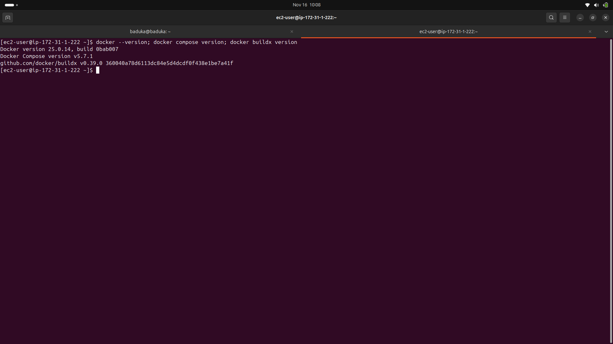
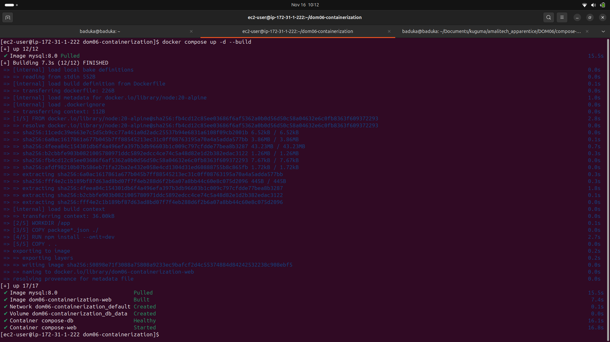
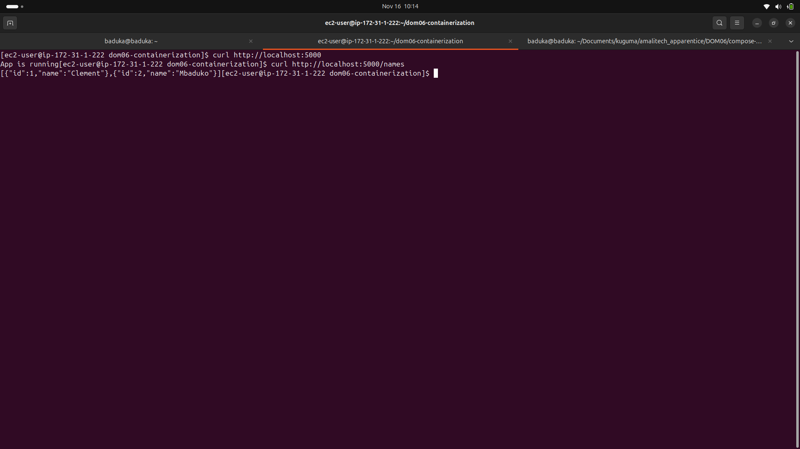
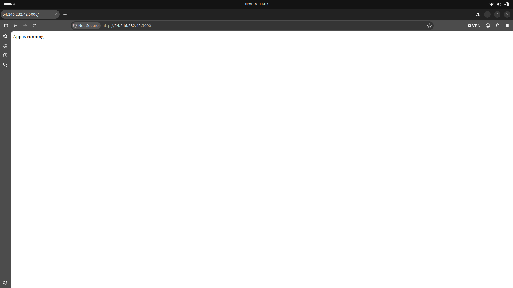
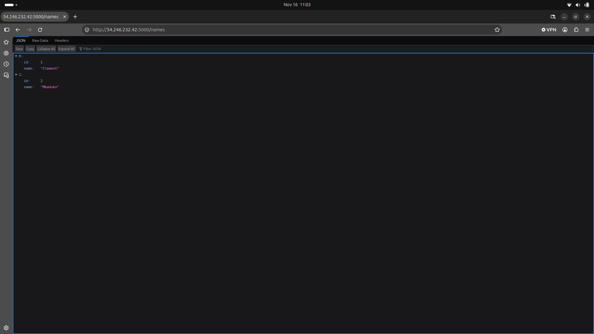
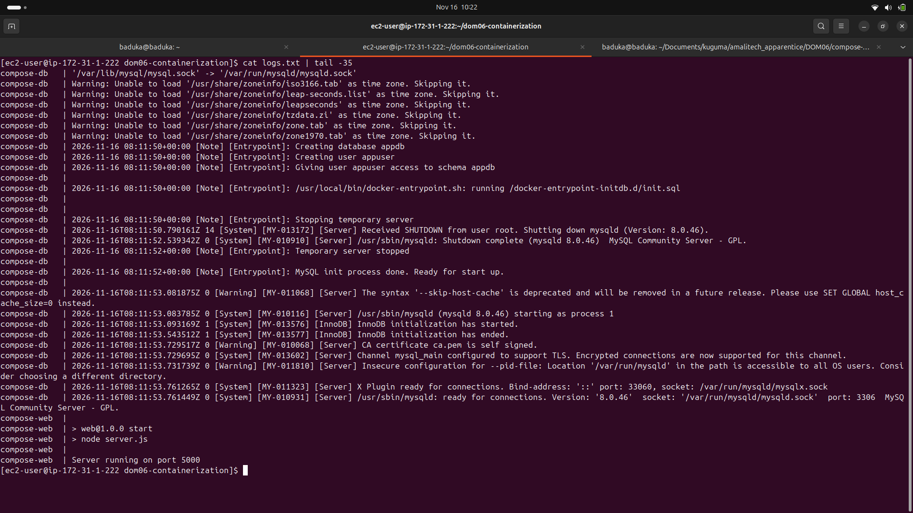
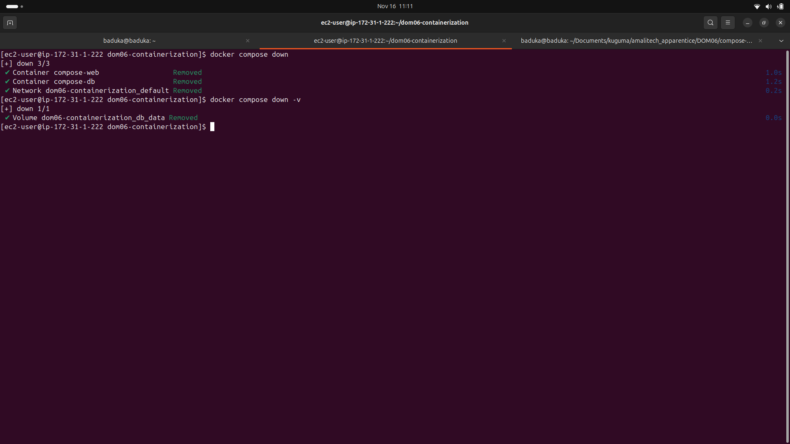

# Compose App

A two-container app run with **Docker Compose**:

- **web**: a Node.js (Express) API built from `web/Dockerfile`
- **db**: a MySQL 8.0 database, seeded from `db/init.sql` on first start

The web app connects to the database through Compose's default network, using the service name `db` as the hostname.

## Project Structure

```
compose-app/
├── docker-compose.yml     # Defines the web and db services, the volume and the healthcheck
├── db/
│   └── init.sql           # Creates the `names` table and inserts sample rows
├── web/
│   ├── Dockerfile         # node:20-alpine image for the API
│   ├── .dockerignore
│   ├── package.json
│   └── app.js             # Express server with two routes
└── screenshots/
```

## How It Works

| Service | Image / Build      | Port        | Purpose                                 |
|---------|--------------------|-------------|-----------------------------------------|
| `db`    | `mysql:8.0`        | 3306 (internal only) | Stores data in the `appdb` database |
| `web`   | built from `./web` | `5000:5000` | Serves the API                          |

- **Healthcheck:** the `db` service runs `mysqladmin ping` every 5 seconds. Because `web` uses `depends_on: condition: service_healthy`, it only starts once MySQL is ready to accept connections.
- **Seeding:** `db/init.sql` is mounted into `/docker-entrypoint-initdb.d/`. MySQL runs it only the first time, when the data volume is empty.
- **Persistence:** the database files are kept in the named volume `db_data`, so the data survives container restarts.
- **Configuration:** the web app reads `DB_HOST`, `DB_USER`, `DB_PASSWORD` and `DB_NAME` from environment variables set in `docker-compose.yml`.

### API Routes

| Method | Route    | Response                                    |
|--------|----------|---------------------------------------------|
| GET    | `/`      | `App is running`: the web container is up   |
| GET    | `/names` | JSON rows from the `names` table: the database connection works |

## Prerequisites

Docker with the Compose plugin. This project was tested on an AWS EC2 instance with:

- Docker 25.0.14
- Docker Compose v5.7.1
- Buildx v0.39.0

```bash
docker --version; docker compose version; docker buildx version
```



## Getting Started

### 1. Build and start the containers

```bash
docker compose up -d --build
```

This pulls `mysql:8.0` and builds the web image. It then creates the network and the `db_data` volume, waits for `compose-db` to become **Healthy**, and starts `compose-web`.



### 2. Test the app

```bash
curl http://localhost:5000
# App is running

curl http://localhost:5000/names
# [{"id":1,"name":"Clement"},{"id":2,"name":"Mbaduko"}]
```



### 3. Open it in the browser

Port `5000` is published on the host, so the app can also be reached from outside the server. On EC2, first allow inbound TCP `5000` in the instance's security group. Then open:

- `http://<EC2_PUBLIC_IP>:5000`



- `http://<EC2_PUBLIC_IP>:5000/names`



### 4. Check the logs

```bash
docker compose logs > logs.txt
tail -35 logs.txt
```

The logs show MySQL creating `appdb` and `appuser`, running `init.sql`, and becoming ready for connections. After that, the web service prints `Server running on port 5000`.



## Useful Commands

```bash
docker compose ps              # list running services and their status
docker compose logs -f web     # follow the web service logs
docker compose exec db mysql -u appuser -papppass appdb   # open a MySQL shell
```

## Stopping

```bash
docker compose down       # stop and remove the containers and network
docker compose down -v    # also delete the db_data volume (init.sql runs again next time)
```

`docker compose down` removes the `compose-web` and `compose-db` containers and the default network. Running `docker compose down -v` afterwards also removes the `db_data` volume.



> **Note:** the credentials in `docker-compose.yml` are for local demo use only. Use an `.env` file or secrets for real deployments.
